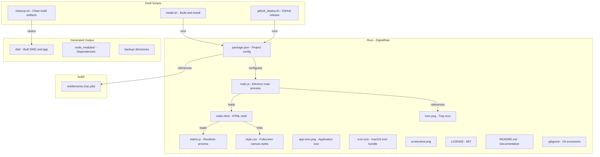
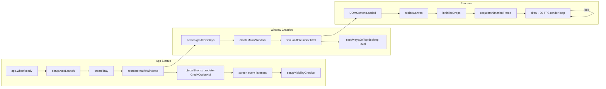
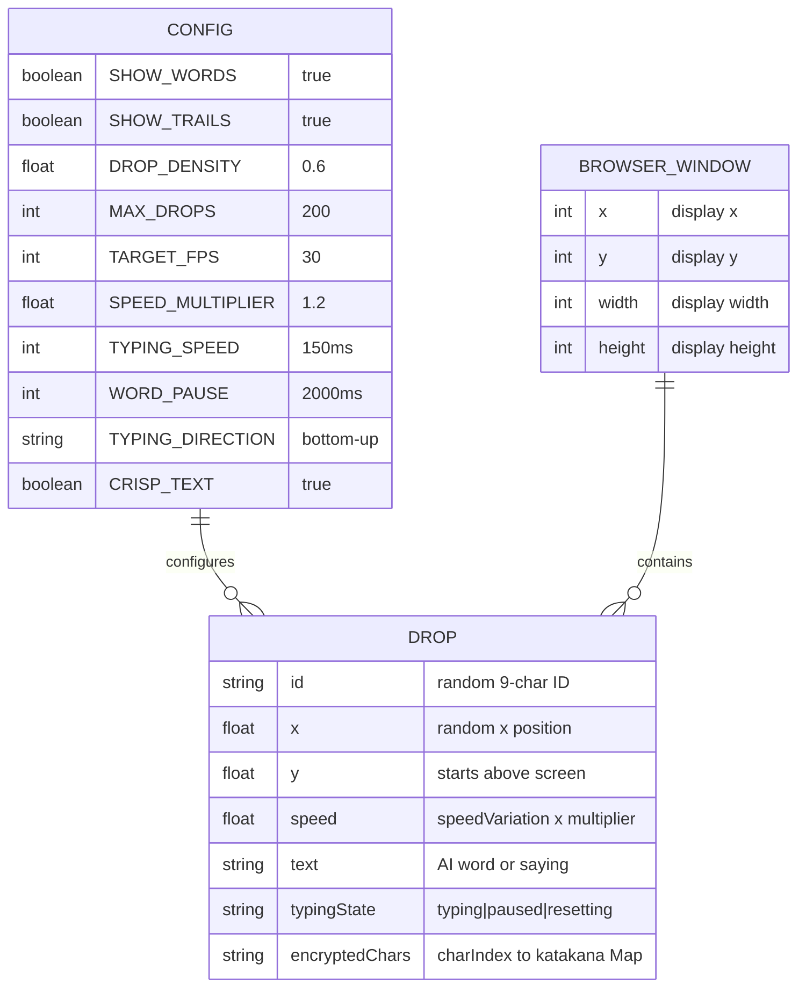
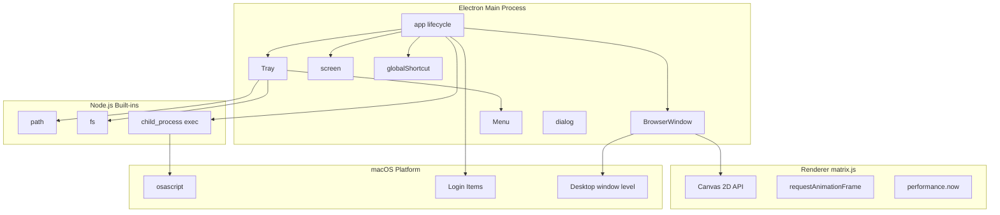
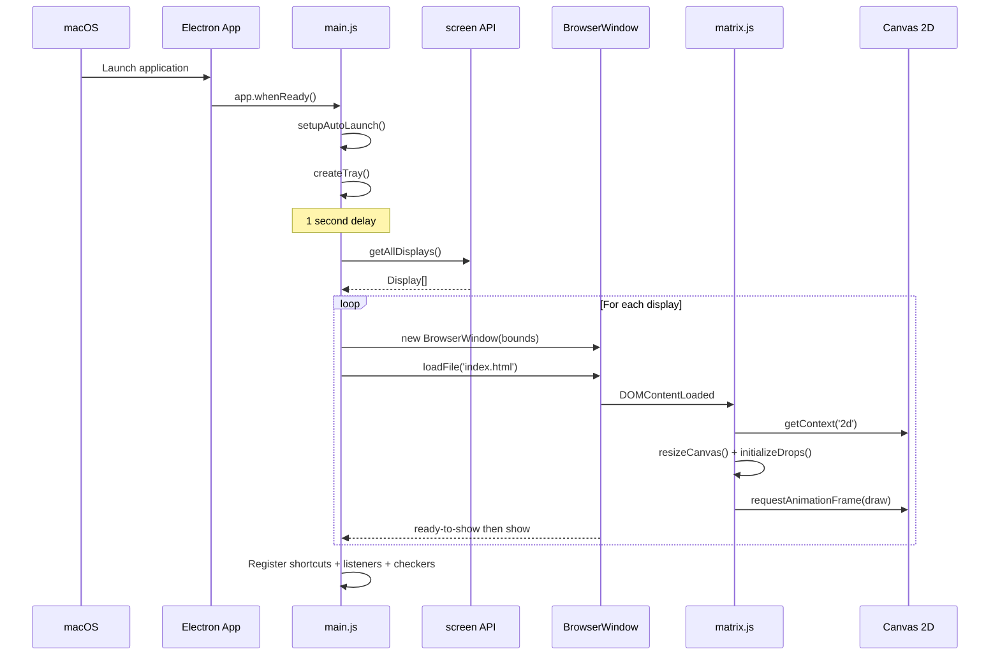
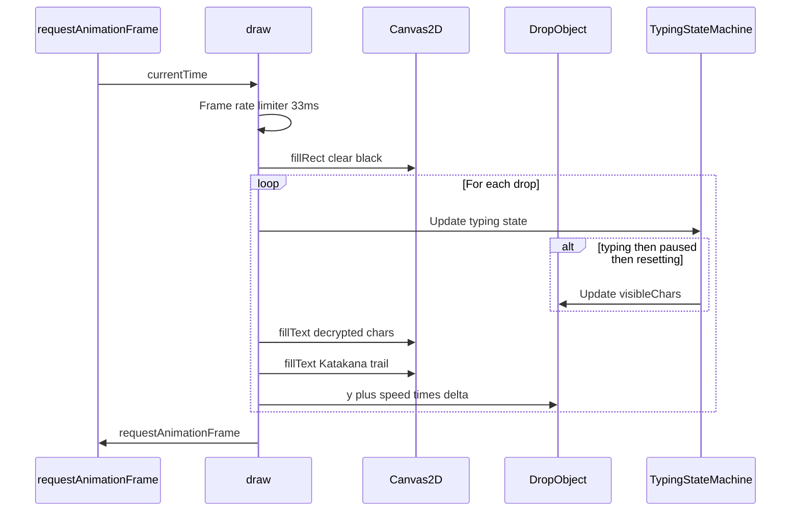
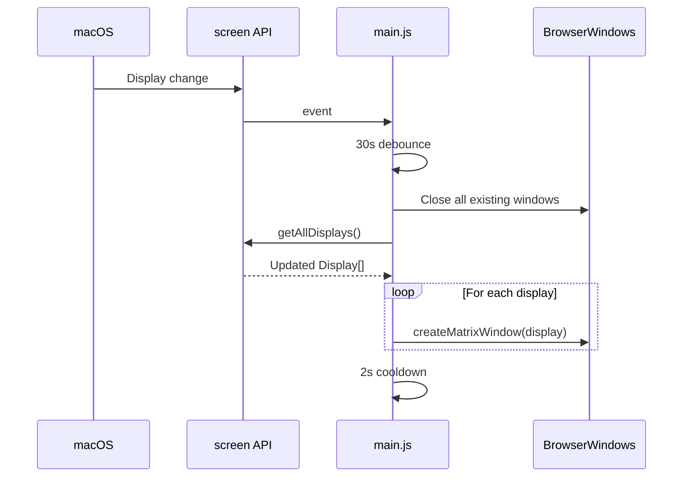
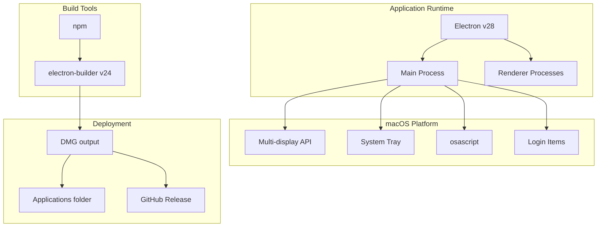
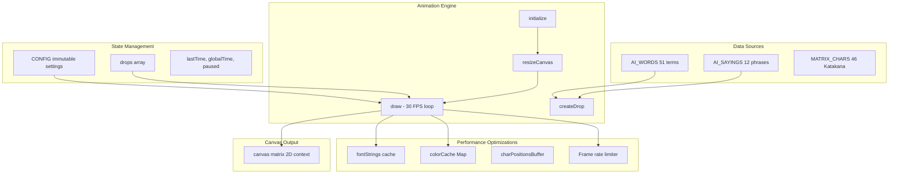
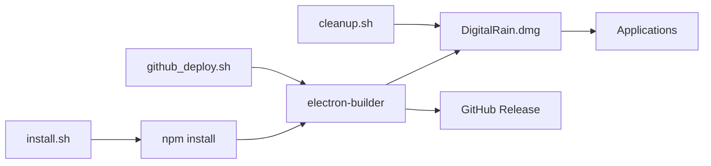

# DigitalRain — Architecture Analysis

> Auto-generated comprehensive architecture analysis with Mermaid diagrams and Neo4j graph database.

---

## 1. Repo Identity Card

| Field | Value |
|-------|-------|
| **Name** | DigitalRain (digital-rain) |
| **Version** | 1.0.0 |
| **Language(s)** | JavaScript (ES6+), HTML5, CSS3, Bash |
| **Framework(s)** | Electron v28.0.0 |
| **Package manager** | npm |
| **Build tool** | electron-builder v24.9.1 |
| **Monorepo?** | No |
| **Architecture pattern** | Electron desktop app — Main process + Renderer process |
| **Entry points** | `main.js` (Electron main), `index.html` → `matrix.js` (renderer) |
| **Total source files** | 12 (excluding node_modules, dist, backups) |
| **Total LOC** | ~1,592 |
| **Platform** | macOS (primary), with fallbacks for Windows/Linux |
| **License** | MIT |
| **Author** | Matty Squarzoni |

---

## 2. Table of Contents

| # | Diagram | File | Description |
|---|---------|------|-------------|
| 1 | [Project Structure](#3-project-structure) | `01-project-structure.mmd` | Directory hierarchy and file relationships |
| 2 | [Request Lifecycle](#4-entry-points--request-lifecycle) | `02-request-lifecycle.mmd` | App startup, window creation, animation loop |
| 3 | [Data Model](#5-data-model) | `03-data-model.mmd` | CONFIG, Drop, and BrowserWindow data structures |
| 4 | [Service Dependencies](#6-service-dependency-map) | `04-service-dependencies.mmd` | Module and API dependencies |
| 5 | [Startup Sequence](#7-critical-flow-sequences) | `05-sequence-app-startup.mmd` | App boot to first frame |
| 6 | [Animation Loop](#7-critical-flow-sequences) | `05-sequence-animation-loop.mmd` | Per-frame render cycle |
| 7 | [Display Change](#7-critical-flow-sequences) | `05-sequence-display-change.mmd` | Monitor add/remove handling |
| 8 | [Infrastructure](#8-infrastructure--integrations) | `06-infrastructure.mmd` | Platform APIs, build tools, deployment |
| 9 | [Security / Auth](#9-security--auth-flow) | `07-auth-flow.mmd` | CSP, Electron security, entitlements |
| 10 | [Client Architecture](#10-client-architecture) | `08-client-architecture.mmd` | Renderer state, animation engine, helpers |
| 11 | [CI/CD Pipeline](#11-cicd--build-pipeline) | `09-cicd-pipeline.mmd` | Build, install, deploy scripts |

---

## 3. Architecture Overview

DigitalRain is a macOS desktop utility that renders a Matrix-style "digital rain" animation as a live wallpaper behind all other application windows. It is built entirely with **Electron v28** and uses the **HTML5 Canvas 2D API** for rendering.

The architecture is a classic two-process Electron app. The **main process** (`main.js`, 527 LOC) manages the application lifecycle: it creates one `BrowserWindow` per connected display, positions each window at desktop level (below all apps, above the wallpaper), configures a system tray icon with a context menu, registers global keyboard shortcuts, and monitors for display configuration changes. The **renderer process** (`matrix.js`, 734 LOC) runs inside each BrowserWindow and drives a canvas-based animation loop at 30 FPS, rendering falling columns of Katakana characters interspersed with AI/ML terminology using a typing-decryption visual effect.

The app has zero external runtime dependencies — all rendering is done with built-in browser APIs. The only npm packages (`electron`, `electron-builder`, `canvas`) are devDependencies used for development and packaging. The entire codebase fits in two JavaScript files, one HTML file, and one CSS file, making it remarkably simple to understand and modify.

---

## 4. Project Structure



---

## 5. Entry Points & Request Lifecycle

### Entry Points

| Type | Location | Trigger |
|------|----------|---------|
| **Electron main** | `main.js:366` | `app.whenReady()` — app launch |
| **Renderer init** | `matrix.js:1` | `DOMContentLoaded` — per-window |
| **Keyboard shortcut** | `main.js:382` | `Cmd+Option+M` — toggle visibility |
| **System tray** | `main.js:226` | Tray icon click — context menu |
| **Display events** | `main.js:385-387` | `display-added/removed/changed` |
| **Periodic: position** | `main.js:358` | Every 5 minutes — `verifyWindowPositions` |
| **Periodic: visibility** | `main.js:515` | Every 60 seconds — check if windows hidden |
| **macOS dock click** | `main.js:493` | `app.activate` — recreate or toggle |

### Exit Points

| Type | Location | Description |
|------|----------|-------------|
| **Canvas rendering** | `matrix.js:317` | `draw()` — fillText/fillRect to canvas |
| **AppleScript exec** | `main.js:187` | `child_process.exec('osascript ...')` |
| **Login items** | `main.js:28` | `app.setLoginItemSettings()` |
| **Console logging** | Throughout | `console.log/error` (debug mode) |



---

## 6. Data Model

This app has no database. All state is held in memory as JavaScript objects.

### Core Data Structures

**CONFIG** (immutable, `matrix.js:61-87`): Animation settings including FPS target, font sizes, drop density, typing speed, and visual toggles.

**Drop** (mutable, `matrix.js:208-258`): Each falling column. Contains position, speed, text content, typing state machine state, trail characters, base color, pulse phase, and an encrypted character cache (Map).

**BrowserWindowConfig** (per-display, `main.js:87-103`): Frameless, non-transparent window matching each display's bounds.



---

## 7. Service Dependency Map



---

## 8. Critical Flow Sequences

### Flow 1: App Startup → First Frame



### Flow 2: Animation Render Loop



### Flow 3: Display Configuration Change



---

## 9. Infrastructure & Integrations

### Dependencies

| Package | Version | Type | Purpose |
|---------|---------|------|---------|
| electron | ^28.0.0 | devDependency | Runtime framework |
| electron-builder | ^24.9.1 | devDependency | macOS DMG packaging |
| canvas | ^3.1.0 | devDependency | Node canvas (build-time only) |

### External Service Integrations

| Service | Type | Used By | Purpose |
|---------|------|---------|---------|
| macOS Display API | Platform | `recreateMatrixWindows` | Multi-monitor detection |
| macOS System Tray | Platform | `createTray` | Menu bar icon |
| macOS AppleScript | Platform | `fixMacOSWindowVisibility` | Window visibility fix |
| macOS Login Items | Platform | `setupAutoLaunch` | Auto-start at boot |
| GitHub Releases | Deployment | `github_deploy.sh` | Distribution |



---

## 10. Security & Auth Flow

This is a **local desktop utility with no authentication, no network communication, and no user input** (mouse events are ignored). Security considerations are minimal but documented.

### Electron Security Settings

| Setting | Value | Location |
|---------|-------|----------|
| `nodeIntegration` | `false` | `main.js:100` |
| `contextIsolation` | `true` | `main.js:101` |
| `setIgnoreMouseEvents` | `true` | `main.js:118` |
| Content Security Policy | `default-src 'self'; script-src 'self'; style-src 'self'` | `index.html:6` |

### macOS Entitlements (`build/entitlements.mac.plist`)

| Entitlement | Value | Reason |
|-------------|-------|--------|
| `app-sandbox` | **false** | Required for desktop-level window positioning |
| `allow-jit` | true | Electron Chromium requirement |
| `allow-unsigned-executable-memory` | true | Electron Chromium requirement |
| `disable-library-validation` | true | Electron native modules |

### Security Observations

- **No sandbox**: Required by design — the app must position windows at the desktop level, which macOS sandboxing prevents.
- **`child_process.exec` with AppleScript**: Used in `fixMacOSWindowVisibility`. The script strings are constructed from hardcoded process name arrays — no user input is interpolated, so command injection risk is effectively zero.
- **`shell` is imported but unused** in `main.js:1` — minor dead code.

---

## 11. Client Architecture (Renderer)



### Typing State Machine

Each drop has a three-state cycle: `typing` → `paused` → `resetting` → `typing`

1. **typing**: Characters appear one at a time (150ms interval), initially encrypted as Katakana, then "decrypting" to reveal the actual text
2. **paused**: Full text visible for 2000ms, trail begins fading in
3. **resetting**: Characters disappear one at a time (75ms interval), then a new word is chosen

---

## 12. CI/CD & Build Pipeline

There is **no CI/CD pipeline** (no GitHub Actions, no `.gitlab-ci.yml`, etc.). Building and deployment are handled entirely through shell scripts.

| Script | Purpose | Command |
|--------|---------|---------|
| `npm start` | Run in dev mode | `electron .` |
| `npm run build` | Package as DMG | `electron-builder --mac` |
| `install.sh` | Build + install to /Applications + auto-launch | `./install.sh` |
| `cleanup.sh` | Remove dist/, backup/, clean node_modules | `./cleanup.sh` |
| `github_deploy.sh` | Tag + build + push to GitHub Releases | `./github_deploy.sh` |



---

## 13. Key Architectural Decisions

1. **Desktop-level window positioning**: Uses `setAlwaysOnTop(true, 'desktop', -1)` to place the window just above the macOS wallpaper but below all apps. This is the core innovation that makes it work as a "live wallpaper."

2. **One window per display**: Each connected monitor gets its own `BrowserWindow` with its own renderer process, allowing independent animation on each screen.

3. **Mouse event passthrough**: `setIgnoreMouseEvents(true)` makes the window completely transparent to user interaction — clicks pass through to whatever app is underneath.

4. **AppleScript fallback**: When Electron's window level APIs aren't sufficient (e.g., after Space switching), the app falls back to AppleScript via `osascript` to force visibility.

5. **Canvas 2D over WebGL**: The animation uses the simpler Canvas 2D API rather than WebGL. This is appropriate given the relatively simple rendering requirements (text only) and maximizes compatibility.

6. **No external runtime dependencies**: Zero npm runtime dependencies. Everything runs on Electron's built-in Chromium + Node.js.

---

## 14. Risk Areas & Technical Debt

### Issues Identified

| Category | Location | Description | Severity |
|----------|----------|-------------|----------|
| **Dead import** | `main.js:1` | `shell` is imported from Electron but never used | Low |
| **No tests** | — | Zero test files, no test framework configured | Medium |
| **No linting** | — | No ESLint, Prettier, or any code quality tooling | Low |
| **Hardcoded config** | `matrix.js:61-87` | CONFIG object is not user-configurable at runtime | Low |
| **Display change debounce** | `main.js:489` | 30-second debounce is extremely long; may feel unresponsive | Medium |
| **Global state** | `main.js:10-18` | Module-level mutable globals (`backgroundWindows`, `isRefreshing`, etc.) | Low |
| **Sandbox disabled** | `entitlements.mac.plist` | Required for functionality but reduces security | Low |
| **No error recovery** | `matrix.js:697` | `initialize()` retries on failure via setTimeout, but could loop forever | Low |
| **Color cache unbounded** | `matrix.js:140` | `colorCache` Map grows without eviction — minor memory leak over very long runtimes | Low |
| **No circular dependencies** | — | Clean dependency graph — no cycles detected | N/A |

### Recommendations

1. **Add a preferences UI** or config file to let users adjust CONFIG values (FPS, colors, density) without editing source code.
2. **Add basic tests** — at minimum, unit tests for `createDrop()`, `rgba()`, and the typing state machine logic.
3. **Cap the colorCache** with an LRU eviction policy or periodic clearing.
4. **Reduce display change debounce** from 30s to ~3-5s for better responsiveness.
5. **Remove unused `shell` import** from main.js line 1.

---

## 15. Neo4j Setup Instructions

### Prerequisites

- Docker and Docker Compose installed

### Quick Start

```bash
cd architecture/neo4j
chmod +x start.sh
./start.sh
```

### Access

| Interface | URL |
|-----------|-----|
| **Browser UI** | http://localhost:7474 |
| **Bolt URI** | bolt://localhost:7687 |
| **Username** | `neo4j` |
| **Password** | `repoanalysis` |

### Management

```bash
# Stop Neo4j
cd architecture/neo4j && docker compose down

# Reset all data
cd architecture/neo4j && docker compose down -v
```

---

## 16. Useful Neo4j Queries

```cypher
-- Full graph overview
MATCH (n) RETURN n;

-- Node type counts
MATCH (n) RETURN labels(n)[0] AS type, count(*) AS count ORDER BY count DESC;

-- Function call graph
MATCH (a:Function)-[:CALLS]->(b:Function)
RETURN a.name AS caller, b.name AS callee;

-- Most called functions
MATCH (f:Function)<-[:CALLS]-(caller:Function)
RETURN f.name, count(caller) AS call_count ORDER BY call_count DESC;

-- Event subscription map
MATCH (f:Function)-[:SUBSCRIBES_TO]->(e:Event)
RETURN e.name AS event, collect(f.name) AS handlers;

-- External service usage
MATCH (f:Function)-[:CALLS_EXTERNAL]->(ext:ExternalService)
RETURN ext.name, collect(f.name) AS calling_functions;

-- Impact analysis: "If I change matrix.js..."
MATCH (changed:File {path: 'matrix.js'})
OPTIONAL MATCH (changed)<-[:IMPORTS*1..3]-(affected:File)
RETURN changed.path, collect(DISTINCT affected.path) AS affected_files;

-- Files by LOC
MATCH (f:File) RETURN f.path, f.loc ORDER BY f.loc DESC;
```

See `architecture/neo4j/scripts/useful-queries.cypher` for the complete query reference.

---

## 17. Glossary

| Term | Meaning in this codebase |
|------|-------------------------|
| **Drop** | A single falling column of text + trailing Katakana characters |
| **Trail** | The stream of Katakana characters falling below the typed word |
| **Typing state** | Three-phase cycle: typing → paused → resetting |
| **Decryption effect** | Characters initially appear as random Katakana, then "decrypt" to reveal the actual letter |
| **Desktop level** | macOS window level that sits above the wallpaper but below all application windows |
| **DPR** | Device Pixel Ratio — used for crisp rendering on Retina/HiDPI displays |
| **CONFIG** | Immutable animation settings object in matrix.js |
| **Background windows** | The array of BrowserWindows, one per display, that render the animation |
| **Pulse** | Sinusoidal brightness oscillation applied to each drop's color |

---

## 18. File Inventory

| File | LOC | Type | Purpose |
|------|-----|------|---------|
| `main.js` | 527 | Main process | Electron app lifecycle, window management, tray, shortcuts |
| `matrix.js` | 734 | Renderer | Canvas animation engine, drop system, typing effect |
| `index.html` | 15 | HTML shell | DOM structure with CSP, loads CSS + JS |
| `style.css` | 39 | Stylesheet | Fullscreen black canvas with crisp rendering |
| `package.json` | 46 | Config | Dependencies, scripts, electron-builder config |
| `build/entitlements.mac.plist` | 20 | Config | macOS security entitlements |
| `install.sh` | 45 | Script | Build and install to /Applications |
| `cleanup.sh` | 128 | Script | Clean build artifacts and backups |
| `github_deploy.sh` | 104 | Script | Tag and deploy to GitHub Releases |
| `.gitignore` | 35 | Config | Git exclusion rules |
| `README.md` | 108 | Docs | User-facing documentation |
| `LICENSE` | 21 | Legal | MIT license |
